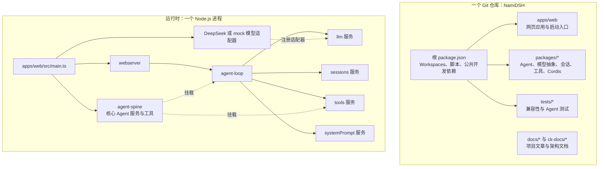

# NamiDSH 的 npm Workspaces 单仓库架构

本文说明 NamiDSH 如何用一个 Git 仓库管理多个 npm workspace，以及这些包启动后如何通过插件协作。两件事经常一起出现，但解决的问题不同：**monorepo / Workspaces 管理代码和包；Cordis 插件体系组织运行时行为。**

## 先看全貌

NamiDSH 是一个学习用的 Agent 项目。代码放在一个仓库里，根目录的 npm Workspaces 识别 `packages/*` 和 `apps/*` 下的包。启动网页应用时，Node.js 在一个进程里加载这些本地包；应用入口将它们组装成一棵插件树。



图的上半部分讲文件和包的管理；下半部分讲应用启动后的服务关系。Workspaces 本身不会启动这些包，也不决定插件的执行顺序或依赖关系。

## 术语拆开看

### Monorepo：一个仓库管理多个相关项目

**Monorepo**（单仓库）是仓库布局和协作方式：多个相互关联的应用、库或模块放在同一个 Git 仓库中。NamiDSH 的网页应用、Agent 组件、插件框架和测试共享同一份版本历史。

Monorepo 不等于“所有代码写成一个模块”。子目录仍然可以有清晰的职责、公开入口和依赖边界。它也不自动意味着每个子包都独立发布、单独部署或拥有独立版本；这些需要额外的发布、版本管理和部署流程。

### npm Workspaces：npm 识别并链接仓库内的包

根目录的 [`package.json`](../package.json) 声明：

```json
{
  "workspaces": ["packages/*", "apps/*"]
}
```

npm 会查找这些目录下带有 `package.json` 的工作区。每个子目录的 `package.json` 提供包名、模块格式和导出入口。安装时，npm 将本地工作区包链接到根 `node_modules`；项目代码因此可以用包名导入，例如：

```ts
import { Context } from '@nami/cordis'
import * as spine from '@nami/dsh-agent-spine'
```

根目录通常是统一安装、启动、测试和类型检查的入口。根 `package-lock.json` 记录依赖解析与本地工作区链接，便于团队按同一份锁文件安装。

## 仓库目录与包职责

```text
NamiDSH/
├── package.json              # workspace 范围、统一命令、根级开发依赖
├── package-lock.json         # npm 锁文件和本地工作区链接
├── tsconfig.json             # packages、apps、tests 共用的类型检查配置
├── apps/
│   └── web/                  # 浏览器聊天应用及 Node.js 启动入口
├── packages/
│   ├── cordis/               # Context、插件注册、服务注入、生命周期和事件
│   ├── llm/                  # 统一的模型调用服务与消息类型
│   ├── llm-deepseek/         # DeepSeek API 适配器
│   ├── llm-mock/             # 离线模拟模型
│   ├── session/              # 会话记录与消息历史
│   ├── tools/                # 工具注册、列出、执行与拦截管线
│   ├── tool-fs/              # 只读文件工具
│   ├── tool-time/            # 获取时间的工具
│   ├── system-prompt/        # 组合系统提示词
│   ├── agent-loop/           # 模型调用和工具调用循环
│   ├── agent-spine/          # 将 Agent 核心服务组合为一个插件
│   └── webserver/            # HTTP 服务、静态页面和流式聊天接口
├── tests/                    # Cordis 兼容性与 Agent 行为测试
├── docs/                     # 配套学习文章
└── ck-docs/                  # 本项目的补充架构文档
```

`apps/web` 是可运行的应用。`packages/*` 是供应用组合使用的 npm 包，不是单独运行的服务。每个包都有自己的 `package.json`，但这并不表示它们都需要独立部署。

| 层次 | 代表目录 | 提供什么 | 主要使用者 |
|---|---|---|---|
| 入口应用 | `apps/web` | 创建根 Context，选择模型适配器并启动网页服务 | 开发者、浏览器 |
| 插件框架 | `packages/cordis` | 插件、服务注入、事件和自动清理 | 其他所有插件 |
| 服务定义 | `llm`、`session`、`tools`、`system-prompt` | 统一接口和运行时服务 | `agent-loop` 等使用方 |
| 服务实现或扩展 | `llm-deepseek`、`llm-mock`、`tool-fs`、`tool-time` | 为抽象服务提供模型或工具 | Agent 和工具运行时 |
| Agent 组合 | `agent-loop`、`agent-spine` | 执行对话循环、组合常用服务 | 网页入口或其他宿主应用 |
| HTTP 宿主 | `webserver` | 将 Agent 能力暴露成网页聊天接口 | `apps/web` |

## 包管理层：根配置和子包配置各自做什么

### 根 `package.json`

根配置管理整个仓库的工作区、命令和共同的开发工具。当前配置包括：

- `workspaces`: `packages/*` 与 `apps/*`。
- `engines`: Node.js `>=22.18`。项目直接运行 TypeScript 源码。
- `start`: `node apps/web/src/main.ts`，启动应用但不自动读取 `.env`。
- `dev`: `node --env-file=.env apps/web/src/main.ts`，从根目录的 `.env` 载入环境变量后启动。
- `test`: 依次运行 `tests/compat.ts` 和 `tests/agent.ts`。
- `check`: 使用根目录的 TypeScript 配置执行 `tsc` 类型检查。

常用命令：

```bash
npm install
npm run dev
npm test
npm run check
```

如果使用 `npm start`，可直接把密钥放进启动命令的环境变量中，例如 `API_KEY=... npm start`。`.env` 已被 `.gitignore` 忽略；不要将密钥提交到仓库。

### 子包 `package.json`

子包配置用 `name` 标识包，例如 `@nami/dsh-agent-loop`，并通过 `exports` 指向源码入口。npm 依据根 `workspaces` 模式发现这些包，再按各自的包名把它们链接到本仓库。

通常，子包还应在自己的 `dependencies` 中准确声明它导入的其他工作区包和外部依赖。**目前 NamiDSH 的不少子包虽然在源码中通过 `@nami/...` 包名互相导入，`package.json` 却没有列出对应的 `dependencies`。** 当前锁文件保留了本地 workspace 链接，因此仓库内的运行方式依赖整体工作区；但包依赖元数据还不完整。若之后要单独安装、发布或校验包边界，应补齐依赖声明，并为目标包验证构建和安装流程。

根工作区配置使多个包便于一起开发，并不自动保证每个包可以脱离仓库独立使用。独立性要通过完整的 `dependencies`、构建产物、导出约定和发布流程来实现。

## 运行时层：Cordis 插件架构

Workspaces 解决“代码放在哪、npm 如何找到本地包”。NamiDSH 的插件架构解决“启动后模块如何提供服务、声明依赖并协作”。运行时插件系统由 `packages/cordis` 实现。

### Context、插件和服务

- **Context**：插件看到的运行环境。插件通过 `ctx.plugin(...)` 安装其他插件，通过 `ctx.provide(...)` 提供服务，通过注入依赖使用服务，也可以监听和发送事件。
- **插件**：一个可以挂载和卸载的功能单元。插件可以是普通函数，也可以是带 `apply` 方法的对象。它可以创建服务、注册工具、挂事件监听或再挂载子插件。
- **服务**：挂到 Context 上、供其他插件使用的运行时能力。例如 `ctx.llm`、`ctx.sessions`、`ctx.tools` 和 `ctx.agentLoop`。
- **依赖注入**：插件声明自己需要哪些服务。依赖未就绪时插件会等待；依赖提供者变化时，Cordis 会更新相关插件状态。
- **effect 清理**：插件注册的监听、工具、子插件、服务器等副作用可以绑定到插件生命周期；插件停止或卸载时执行清理，避免遗留注册。

这里的“运行时依赖”由插件的服务注入关系表达，和 npm `package.json` 中的包依赖不是同一件事。前者回答“插件启动需要哪些服务”；后者回答“加载这个 npm 包需要哪些包”。

### Agent Spine：常用核心服务的组合插件

[`packages/agent-spine/src/index.ts`](../packages/agent-spine/src/index.ts) 负责一次挂载常用 Agent 能力：

1. 创建 `llm`、`sessions`、`tools` 和 `systemPrompt` 服务。
2. 挂载 `tool-time` 与 `tool-fs` 插件，向工具服务登记 `get_time`、`list_dir` 和 `read_file`。
3. 挂载 `agent-loop`，它依赖模型、工具、会话和系统提示词服务。

它刻意不选择“连接哪家模型”，也不决定应用入口。模型适配器和网页服务由 `apps/web` 挂载，这样核心 Agent 可以在其他宿主中复用。

### 网页应用启动顺序

[`apps/web/src/main.ts`](../apps/web/src/main.ts) 的启动流程是：

1. 创建根 `Context`。
2. 挂载 `agent-spine`，并把 `WORKSPACE`（未设置时为当前目录）交给文件工具作为访问根目录。
3. 如果设置了 `API_KEY` 或 `DEEPSEEK_API_KEY`，挂载 DeepSeek 适配器；没有密钥则挂载 mock 离线模型。
4. 挂载 `webserver`，默认监听本机 `3000` 端口。

网页入口和所有被挂载插件作为 JavaScript/TypeScript 模块运行在同一个 Node.js 进程中。仓库目录的分包不等于微服务拆分；这里没有为每个 workspace 单独启动网络服务或容器。

## 一次网页聊天如何流转

```mermaid
sequenceDiagram
  actor User as 用户
  participant Browser as 浏览器页面
  participant Web as webserver
  participant Loop as agent-loop
  participant Session as sessions
  participant LLM as llm 服务
  participant Adapter as DeepSeek 或 mock
  participant Tools as tools / 工具插件

  User->>Browser: 输入消息
  Browser->>Web: POST /api/chat
  Web->>Session: 获取或创建会话
  Web->>Loop: run(session, message)
  Loop->>Session: 记录用户消息
  Loop->>LLM: 消息历史 + 工具清单
  LLM->>Adapter: 统一格式的流式调用
  Adapter-->>LLM: 文本片段或工具调用
  LLM-->>Loop: StreamChunk
  Loop-->>Web: agent 事件（文本增量 / 工具调用）
  Web-->>Browser: SSE delta / tool
  opt 模型请求调用工具
    Loop->>Tools: 执行工具
    Tools-->>Loop: 工具结果
    Loop->>Session: 记录工具调用与结果
    Loop->>LLM: 带工具结果再次请求
    LLM->>Adapter: 继续生成
    Adapter-->>LLM: 最终文本
    LLM-->>Loop: 文本片段
    Loop-->>Web: agent/text-delta
    Web-->>Browser: SSE delta
  end
  Web-->>Browser: SSE done
```

在实现中，网页服务监听 Agent 事件并通过 Server-Sent Events（SSE）转发给浏览器。Agent Loop 每轮把系统提示词、会话消息和工具定义交给 `llm`；如果模型返回工具调用，就交给 `tools` 执行，把结果写回会话，再继续请求模型，直到得到最终文本或达到最大步数。

## 为什么这样拆分

### 对项目开发的帮助

- **代码和接口一起修改**：模型服务与适配器在一个仓库中，可以同步更新统一接口和实现。
- **本地包即时联调**：workspace 链接指向仓库源码，修改包后可以从应用入口直接验证，不必先发布到 registry。
- **根目录统一操作**：安装、类型检查和测试命令一致，单一 lockfile 记录项目依赖解析。
- **按职责定位代码**：网页入口、模型、工具、会话和 Agent 循环分开，便于阅读和测试。
- **实现可替换**：Agent Loop 依赖统一的 `llm` 服务，而不是直接绑定具体模型 API；工具也通过注册表提供给模型。
- **生命周期可管理**：插件的注册和清理随插件挂载/卸载，测试可以演示加审批插件、移除工具或模型服务后的行为。

### 它不自动提供的能力

- **不自动拆成微服务**：所有插件在应用中同进程运行。
- **不自动让每个包可独立发布**：子包仍需完整依赖、构建和导出元数据。
- **不自动保证边界合理**：workspace 允许互相导入，不代表没有循环依赖或错误层级；边界仍靠设计和检查维护。
- **不必然优于单包**：包数量增加后，命名、依赖维护和目录跳转也会增加。很小的应用可能用一个包更直接。

## 怎样扩展仓库

### 添加一个 workspace 包

1. 在 `packages/` 下创建目录，例如 `packages/llm-compatible/`。
2. 新建 `package.json`，设置唯一包名、`type: "module"` 和公开入口 `exports`。
3. 在源码中实现对应接口；需要其他 workspace 的能力时，在 `package.json` 中声明包依赖。
4. 在使用它的应用或组合插件里，通过包名导入并挂载。
5. 运行 `npm install` 更新锁文件，再运行 `npm run check` 和相关测试。

适配器通常实现 `LlmAdapter` 并调用 `ctx.llm.registerAdapter(...)`；工具插件通常向 `ctx.tools.register(...)` 登记工具。若新插件要提供 Agent 可用的新能力，不需要把平台细节塞进 `agent-loop`。

### 添加一个应用

在 `apps/` 新建应用目录及 `package.json`，由它负责自己的入口、配置和宿主方式。需要复用 Agent 时，可以挂载 `agent-spine`；如果入口不是网页，也可使用同一套会话、模型和工具服务而不依赖 `webserver`。

## 项目命令与入口速查

| 任务 | 命令 | 说明 |
|---|---|---|
| 安装依赖 | `npm install` | 从根目录安装开发依赖并建立本地 workspace 链接 |
| 使用 `.env` 启动 | `npm run dev` | 根目录 `.env` 由 Node 的 `--env-file` 载入 |
| 直接启动 | `npm start` | 默认 `http://localhost:3000`；需在 shell 环境中提供配置 |
| 运行测试 | `npm test` | 兼容性测试和 Agent 测试 |
| 类型检查 | `npm run check` | 扫描 `packages/*/src`、`apps/*/src` 和 `tests` |

主要配置：`API_KEY` 或 `DEEPSEEK_API_KEY`、可选 `BASE_URL`、`MODEL`、`PORT`、`WORKSPACE`。没有 Key 时应用选择离线 mock 模型。`BASE_URL` 与 `MODEL` 应与同一 API 服务提供商相匹配。

## 阅读代码的建议顺序

1. [`package.json`](../package.json)：看清根工作区范围和命令。
2. [`apps/web/src/main.ts`](../apps/web/src/main.ts)：跟踪应用如何组装插件。
3. [`packages/agent-spine/src/index.ts`](../packages/agent-spine/src/index.ts)：看核心服务和工具怎样组合。
4. [`packages/agent-loop/src/index.ts`](../packages/agent-loop/src/index.ts)：看一次请求怎样进行模型与工具循环。
5. [`packages/cordis/src/registry.ts`](../packages/cordis/src/registry.ts) 和 [`packages/cordis/src/fiber.ts`](../packages/cordis/src/fiber.ts)：理解插件注册、依赖等待和生命周期清理。
6. [`packages/webserver/src/index.ts`](../packages/webserver/src/index.ts)：看 Agent 事件怎样转成网页 SSE 响应。
7. [`tests/agent.ts`](../tests/agent.ts)：运行时验证乱序挂载、拦截、卸载与依赖停止。

## 小结

NamiDSH 可以看成两层架构：npm Workspaces 把应用和库组织在一个仓库内，方便本地协作与统一管理；Cordis 插件体系在应用运行时组合服务、适配器和工具。前者是**代码组织与包管理**，后者是**进程内的模块协作与生命周期**。理解这条边界，就不会把“一个仓库里有很多包”误认为“有很多独立服务”。
